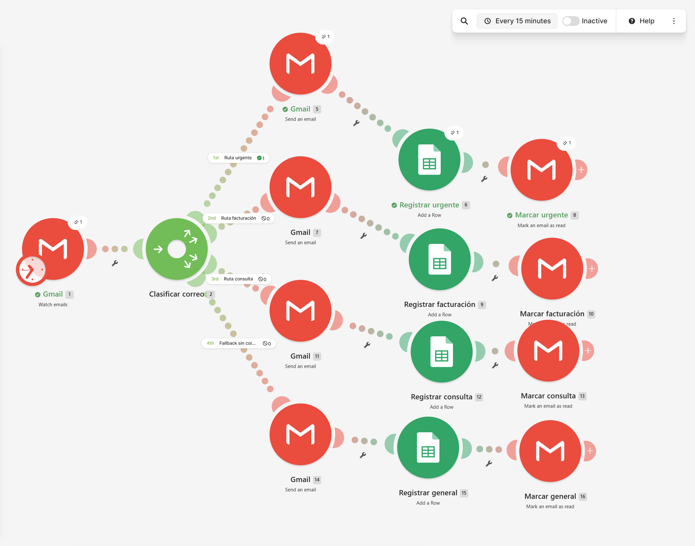

# make-smart-email-workflow


Automatización en [Make](https://www.make.com) que **clasifica los correos entrantes de Gmail, responde automáticamente y registra cada caso en Google Sheets**.

La **versión 1** es un clasificador determinista basado en palabras clave. La **versión 2** (planeada) reemplazará las reglas por un modelo de IA (Gemini) y conservará el mismo registro, de modo que ambas versiones puedan compararse.



---

## Contenido

- [Qué hace](#qué-hace)
- [Arquitectura](#arquitectura)
- [Reglas de clasificación](#reglas-de-clasificación)
- [Registro en Google Sheets](#registro-en-google-sheets)
- [Estructura del repositorio](#estructura-del-repositorio)
- [Instalación: importar el blueprint](#instalación-importar-el-blueprint)
- [Pruebas](#pruebas)
- [Consumo de créditos](#consumo-de-créditos)
- [Limitaciones conocidas](#limitaciones-conocidas)
- [Roadmap](#roadmap)

---

## Qué hace

Cada 15 minutos, el escenario revisa la bandeja de entrada y, por cada correo no leído:

1. **Lo clasifica** en una de cuatro categorías: Urgente, Facturación, Consulta o General.
2. **Responde al remitente** con una plantilla según la categoría.
3. **Registra el caso** en una hoja de Google Sheets: fecha, remitente, asunto, categoría y prioridad.
4. **Lo marca como leído** en Gmail.

Cada correo recibe **exactamente una** respuesta y genera **exactamente una** fila, aunque contenga palabras de varias categorías.

---

## Arquitectura

```
                      ┌────────────────────────────────┐
                      │ [1] Gmail · Watch emails       │
                      │ INBOX · is:unread · máx. 10    │
                      │ cada 15 minutos                │
                      └───────────────┬────────────────┘
                                      │ 1 bundle por correo
                                      ▼
                      ┌────────────────────────────────┐
                      │ [2] Router "Clasificar correo" │
                      └───────────────┬────────────────┘
          ┌──────────────────┬────────┴─────────┬──────────────────┐
          ▼                  ▼                  ▼                  ▼
     1 · Urgente      2 · Facturación     3 · Consulta       4 · Respaldo
          U               F ∧ ¬U           C ∧ ¬U ∧ ¬F       ¬U ∧ ¬F ∧ ¬C
  ┌───────────────┐  ┌───────────────┐  ┌───────────────┐  ┌───────────────┐
  │ [5] Gmail     │  │ [7] Gmail     │  │ [11] Gmail    │  │ [14] Gmail    │
  │ Responder     │  │ Responder     │  │ Responder     │  │ Responder     │
  ├───────────────┤  ├───────────────┤  ├───────────────┤  ├───────────────┤
  │ [6] Sheets    │  │ [9] Sheets    │  │ [12] Sheets   │  │ [15] Sheets   │
  │ Add a Row     │  │ Add a Row     │  │ Add a Row     │  │ Add a Row     │
  ├───────────────┤  ├───────────────┤  ├───────────────┤  ├───────────────┤
  │ [8] Gmail     │  │ [10] Gmail    │  │ [13] Gmail    │  │ [16] Gmail    │
  │ Marcar leído  │  │ Marcar leído  │  │ Marcar leído  │  │ Marcar leído  │
  └───────────────┘  └───────────────┘  └───────────────┘  └───────────────┘

  U = palabra urgente · F = palabra de facturación · C = palabra de consulta
```

Los números entre corchetes son los IDs de los módulos en el blueprint.

### Cómo se garantiza una sola ruta por correo

El Router de Make **no se detiene en la primera ruta que coincide**: evalúa todas las rutas en orden y envía el correo a cada una cuyo filtro se cumpla. Para lograr un comportamiento de *primera coincidencia*, cada ruta excluye las palabras clave de las rutas con mayor prioridad (las fórmulas del diagrama). Así, las cuatro condiciones son mutuamente excluyentes y en conjunto cubren todos los casos: cada correo cumple exactamente una.

El razonamiento completo, las alternativas evaluadas y el costo en créditos están en [`docs/arquitectura-v1.md`](docs/arquitectura-v1.md).

---

## Reglas de clasificación

La comparación es **"contiene" sin distinguir mayúsculas** (`text:contain:ci`) y se aplica al **asunto** y al **cuerpo** del correo.

| Prioridad de evaluación | Categoría | Palabras clave | Prioridad asignada |
|:---:|---|---|:---:|
| 1 | 🔴 **Urgente** | `urgente`, `emergencia` | Alta |
| 2 | 🟠 **Facturación** | `factura`, `pago`, `cobro` | Media |
| 3 | 🔵 **Consulta** | `duda`, `consulta`, `pregunta` | Baja |
| 4 | ⚪ **General** | *(ninguna de las anteriores)* | Baja |

Si un correo contiene palabras de varias categorías, gana la de mayor prioridad. Por ejemplo, *"URGENTE: error en la factura 4512"* se clasifica como **Urgente**.

### Respuestas automáticas

Cada ruta envía `Re: <asunto original>` al remitente:

| Categoría | Mensaje |
|---|---|
| Urgente | Hemos recibido tu mensaje y lo hemos marcado como **Urgente** con prioridad **Alta**. Nuestro equipo lo atenderá lo antes posible. |
| Facturación | Hemos recibido tu mensaje relacionado con **Facturación** y lo hemos clasificado con prioridad **Media**. Revisaremos tu solicitud y te responderemos pronto. |
| Consulta | Hemos recibido tu consulta y la hemos clasificado como **Consulta**, con prioridad **Baja**. Nuestro equipo revisará tu mensaje y te responderá pronto. |
| General | Hemos recibido tu mensaje y lo hemos clasificado como **General**, con prioridad **Baja**. Revisaremos tu solicitud y te responderemos pronto. |

---

## Registro en Google Sheets

Hoja: **`Registro de Correos`**. Los encabezados deben escribirse exactamente así, porque el blueprint los usa como identificadores de columna. La plantilla está en [`templates/registro-correos.csv`](templates/registro-correos.csv).

| Columna | Contenido | Ejemplo |
|---|---|---|
| **Fecha** | Fecha del correo, hora del centro de México (`YYYY-MM-DD HH:mm`) | `2026-11-06 10:30` |
| **Remitente** | Dirección del remitente | `usuario@ejemplo.com` |
| **Asunto** | Asunto original | `URGENTE: Se me cayó mi lente de contacto` |
| **Categoría** | Urgente · Facturación · Consulta · General | `Urgente` |
| **Prioridad** | Alta · Media · Baja | `Alta` |
| **Versión Make** | Versión del clasificador que procesó el correo | `v1 - Reglas` |
| **Respuesta Enviada** | Plantilla de respuesta utilizada | `Urgente` |

La columna **Versión Make** permite comparar la v1 contra la futura v2 (`v2 - Gemini IA`) sobre la misma hoja.

---

## Estructura del repositorio

```
make-smart-email-workflow/
├── README.md                         ← este documento
├── .gitignore
├── blueprints/
│   └── v1-reglas.blueprint.json      ← escenario exportado de Make, sin datos personales
├── docs/
│   └── arquitectura-v1.md            ← decisiones de diseño del Router y costo en créditos
├── templates/
│   └── registro-correos.csv          ← encabezados de la hoja de registro
└── assets/
    └── escenario-v1.png              ← captura del escenario en Make
```

Cuando exista la versión 2, se agregarán `blueprints/v2-gemini.blueprint.json` y `docs/arquitectura-v2.md`.

---

## Instalación: importar el blueprint

### Requisitos

- Una cuenta de [Make](https://www.make.com). El plan gratuito sirve para probar; revisa antes la sección [Consumo de créditos](#consumo-de-créditos).
- Una cuenta de **Gmail**, que será la bandeja vigilada y la que envíe las respuestas.
- Una cuenta de **Google** con acceso a Google Sheets. Puede ser la misma.

### 1. Crear la hoja de registro

1. Descarga [`templates/registro-correos.csv`](templates/registro-correos.csv).
2. En Google Sheets: **Archivo → Importar → Subir** y elige el archivo.
3. Cambia el nombre de la pestaña a **`Registro de Correos`**, exactamente así.

### 2. Importar el escenario

1. En Make, entra a **Scenarios → Create a new scenario**.
2. En la barra inferior del editor, abre el menú **⋯** y elige **Import Blueprint**.
3. Selecciona [`blueprints/v1-reglas.blueprint.json`](blueprints/v1-reglas.blueprint.json) y pulsa **Save**.

### 3. Conectar tus cuentas

El blueprint no incluye conexiones. Abre cada módulo y selecciona o crea la tuya:

| Módulos | Conexión |
|---|---|
| Gmail: 1, 5, 7, 8, 10, 11, 13, 14, 16 | **Gmail** (`google-email`) |
| Google Sheets: 6, 9, 12, 15 | **Google** (`google`) |

### 4. Apuntar a tu hoja

En cada módulo **Add a Row** (6, 9, 12 y 15):

1. En **Spreadsheet ID**, reemplaza `REEMPLAZAR_CON_EL_ID_DE_TU_HOJA` con el ID de tu hoja; también puedes buscarla con el botón de búsqueda. El ID es la parte de la URL entre `/d/` y `/edit`.
2. En **Sheet Name** elige `Registro de Correos`.
3. Verifica que las siete columnas aparezcan ya mapeadas.

### 5. Probar y activar

1. Desde **otra cuenta de correo**, envía uno de los [correos de prueba](#pruebas). No uses la misma cuenta vigilada: la respuesta llegaría a su propia bandeja y el escenario podría responderse a sí mismo.
2. Pulsa **Run once** y revisa el historial de ejecución: solo una ruta debe mostrar actividad.
3. Configura el intervalo en el reloj del módulo 1 y activa el escenario con el interruptor **Scheduling**.

---

## Pruebas

Resultados esperados de la lógica de filtros del blueprint. Se verificaron simulando los filtros con todas las combinaciones de palabras clave en asunto y cuerpo: en todos los casos se cumple exactamente una ruta.

| Asunto | Cuerpo | Categoría esperada | Por qué |
|---|---|---|---|
| URGENTE: Se me cayó mi lente | Prueba de filtro | Urgente | `urgente` en el asunto |
| URGENTE: error en la factura 4512 | No coincide el monto | Urgente | Urgente tiene prioridad sobre Facturación |
| Pago de colegiatura | Adjunto comprobante | Facturación | `pago` |
| Pregunta sobre el pago | Es urgente | Urgente | `urgente` en el cuerpo tiene la máxima prioridad |
| Tengo una duda | ¿Cuál es el horario? | Consulta | `duda` |
| Reunión del viernes | Nos vemos a las 10 | General | ninguna palabra clave |
| Emergencia en laboratorio | *(vacío)* | Urgente | `emergencia` |

Después de cada prueba, comprueba que haya **una** respuesta en el correo de prueba y **una** fila nueva en la hoja.

---

## Consumo de créditos

Según la [documentación de Make](https://help.make.com/how-features-use-credits), el Router y los filtros **no consumen créditos**, y el trigger consume **1 crédito por revisión aunque no encuentre correos nuevos**.

| Concepto | Créditos |
|---|---|
| Cada revisión del trigger | 1 |
| Cada correo procesado (responder + registrar + marcar) | 3 |

El sondeo tiene un costo fijo, aunque no lleguen correos:

| Intervalo | Revisiones al mes | Créditos solo por revisar |
|---|---|---|
| 15 min | ≈2,880 | ≈2,880 |
| 30 min | ≈1,440 | ≈1,440 |
| 60 min | ≈720 | ≈720 |

> ⚠️ El plan gratuito de Make incluye **1,000 créditos al mes** ([precios](https://www.make.com/en/pricing)). Con el intervalo de 15 minutos, solo las revisiones agotan ese saldo en unos 10 días. Para dejarlo activo todo el mes en el plan gratuito, usa un intervalo de 60 minutos o más.

Con el límite de 10 correos por revisión y un intervalo de 15 minutos, el escenario procesa hasta 40 correos por hora. Los que excedan el límite se procesan en la siguiente revisión.

---

## Limitaciones conocidas

La v1 es intencionalmente simple. Estas limitaciones son la motivación de la v2:

- **Coincidencia por subcadena.** `duda` también coincide con *"in**duda**blemente"*, así que ese correo se clasifica como Consulta.
- **Variantes no cubiertas.** *"Urgencia"*, *"urge"* o *"ASAP"* no contienen `urgente`, por lo que esos correos no se marcan como urgentes.
- **Texto citado.** En una respuesta encadenada, el cuerpo incluye el mensaje anterior: si este decía "urgente", la respuesta también se clasifica como Urgente.
- **Responde a todo lo no leído.** Boletines, notificaciones y direcciones `no-reply` también reciben respuesta. Puedes acotarlo cambiando el filtro del trigger a **Gmail search**, por ejemplo con `is:unread category:primary -from:(noreply OR no-reply OR mailer-daemon)`.
- **Riesgo de bucle con autorrespuestas.** Si el remitente tiene un mensaje automático de ausencia que repite el asunto, ambos sistemas pueden responderse entre sí.
- **Sin ruta de error.** Si falla el envío, el correo no se registra y queda sin leer. Tras varios errores seguidos, Make desactiva el escenario; el blueprint usa 3 (*Scenario settings → Errors before deactivation*).

---

## Roadmap

- [x] **v1 · Reglas.** Router con filtros excluyentes, respuestas por plantilla y registro en Sheets.
- [ ] **v1.1 · Mantenimiento.** Migrar el Router a los módulos **If-else + Merge** de Make, que tienen primera coincidencia nativa. Así las acciones se definen una sola vez y desaparecen las condiciones de exclusión. Ver [análisis](docs/arquitectura-v1.md#5-alternativa-if-else--merge).
- [ ] **v2 · Gemini IA.** Clasificar y redactar la respuesta con Gemini, conservando el mismo registro (`Versión Make = v2 - Gemini IA`) y usando las reglas de la v1 como respaldo si la IA falla.

---

## Documentación

| Documento | Contenido |
|---|---|
| [`docs/arquitectura-v1.md`](docs/arquitectura-v1.md) | Por qué un Router con filtros excluyentes, alternativas evaluadas, garantía de una sola ruta, créditos y mantenimiento |
